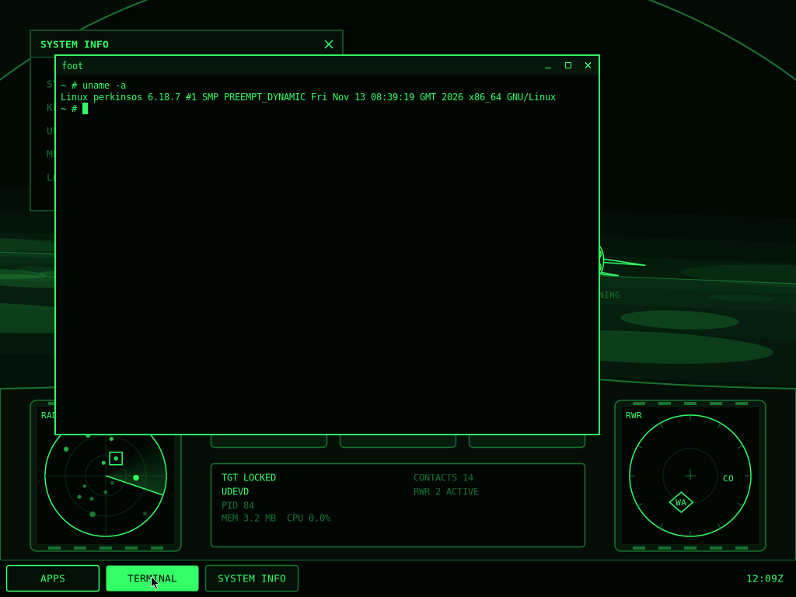
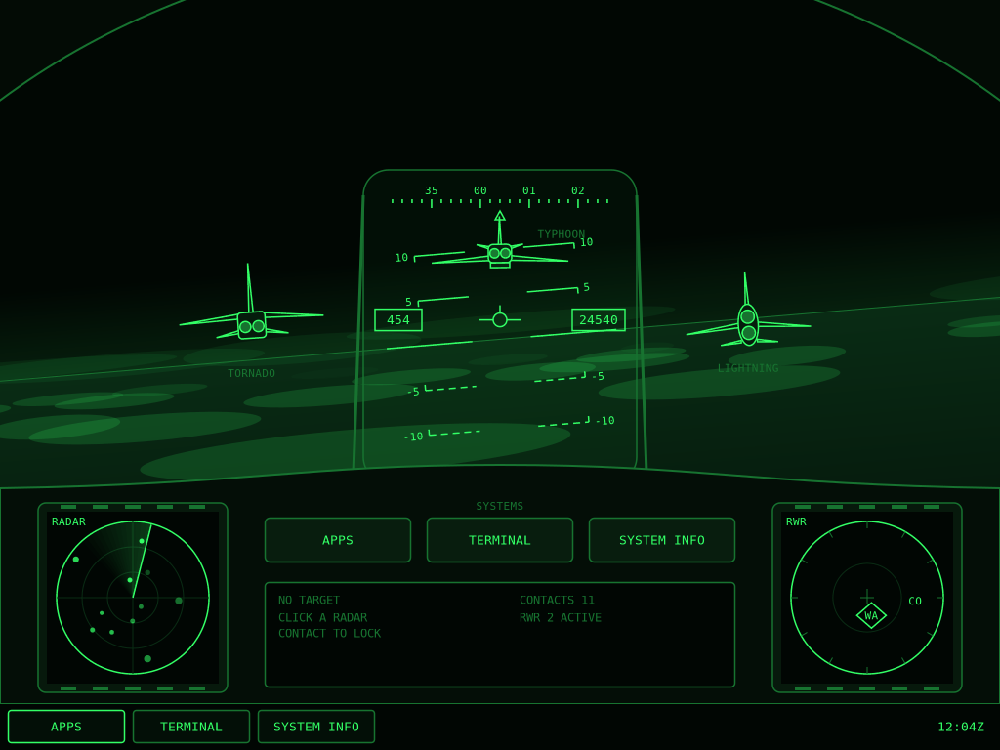

# PerkinsOS

A custom Linux-based desktop OS. The kernel is real Linux; the desktop on top of it is this repo: a Wayland compositor, dock, launcher and an app, booting straight to the desktop in QEMU. The desktop is the view from a fighter cockpit: a Typhoon and an F-35 fly in formation ahead of you over sea and cloud, seen through the HUD, and the instrument panel has a radar and a radar warning receiver that show the machine's running programs, plus keys that start apps. The aircraft are 3D models, lit and drawn by a small software renderer. They are downloaded models converted to a simple mesh format (see Credits).

[](https://github.com/Maxcmperkins/PerkinsOS/actions/workflows/ci.yml)





Both are produced by `make demo` from headless boots: every frame is a screenshot of the real VM, driven by injected key presses and mouse clicks. The still is at 1920x1080; the GIF is half-size and limited to 252 colours.

## What it is

| Part | Source |
| --- | --- |
| Linux kernel, Mesa, libinput, wlroots, foot | Upstream, built from source by Buildroot |
| Compositor (`compositor/`) | Forked from TinyWL (wlroots 0.19.2); wallpaper, borders, keybindings, layer-shell, maximize, Alt+Tab and Alt+drag move/resize added |
| Wallpaper, dock, launcher, System Info app (`shell/`) | Written for this project: plain C on wayland-client, cairo and xkbcommon |
| Aircraft models | Downloaded from Sketchfab (see Credits) and converted by [tools/glb2mesh.py](tools/glb2mesh.py) |
| Boot-to-desktop init (`buildroot/overlay/`) | Written for this project |
| Build and test VM for Ubuntu (`distro/`) | Written for this project |
| Build, tests, CI (`Makefile`, `buildroot/`, `ci/`) | Written for this project |

The code written for this project was written with AI assistance (Claude). Every change to the TinyWL fork is marked `PerkinsOS:` in [compositor/tinywl.c](compositor/tinywl.c), and `git diff 068d7ce -- compositor/` shows exactly what was added to stock TinyWL.

## Architecture

```
QEMU (x86_64, virtio-gpu)
└── Linux kernel
    └── init (boots straight to desktop)
        └── PerkinsOS compositor (wlroots)
            ├── wallpaper    (layer-shell client, background layer)
            ├── dock         (layer-shell client, bottom edge)
            ├── launcher     (layer-shell client, overlay, takes the keyboard)
            └── apps         (xdg-shell clients)
```

More in [docs/ARCHITECTURE.md](docs/ARCHITECTURE.md).

## Using it

| Key | Action |
| --- | --- |
| Alt+P, or the dock's Apps button | Open the launcher: type to filter, Enter to start, Escape to cancel |
| Alt+Enter | Open a terminal |
| Alt+Q | Close the focused window |
| Alt+Tab, or Alt+F1 | Switch to the next window |
| Alt+left-drag | Move the window under the pointer, from anywhere in it |
| Alt+right-drag | Resize the window under the pointer, from the corner nearest the pointer |
| Alt+Escape | Quit the compositor |

Click a window to focus it. Drag a title bar to move a window. To shut down or restart, open the launcher and type "shut" or "restart".

On a system with installed apps (see "On Ubuntu" below), the launcher lists every app that has a `.desktop` file, and any app named in `~/.config/perkinsos/pinned` gets a button on the dock and in the cockpit.

The cockpit is live:

- **Buttons** round the centre display start apps, like the dock's buttons. Each has its name lit on the glass beside it, as on a real cockpit screen, and lights up under the pointer.

- **Radar** (left screen): every contact is a running program. Older programs sit near the centre; one you have just started appears at the edge. Bigger dots use more memory. Hover a contact to see what it is in the data display between the screens; click to lock it and keep its name, PID, memory and CPU there. Click again to break the lock.
- **RWR** (right screen): every symbol is a program using the CPU right now, labelled with the first two letters of its name. The busier it is, the closer to the centre; the busiest gets a diamond.

- **Dials** (on a wide screen): CPU, memory, load average and number of running programs. Beside them, four small standby gauges show the flight: speed, altitude, heading and climb rate.

The flight (heading, speed, altitude, and the standby gauges that show it) is a simulation; the radar, RWR and dials are real data from `/proc`.

### Frame rate

Nothing here uses a graphics card: every pixel is computed by the CPU, inside a virtual machine. Without KVM (hardware virtualisation) QEMU emulates that CPU in software and the desktop manages about 13 frames a second at 1920x1080. With KVM it should reach its cap of 30. See step 4 of [docs/SETUP.md](docs/SETUP.md). The wallpaper measures itself and writes its frame rate, and where the time goes, to `/var/log/desktop.log` every ten seconds. `make run SCREEN=1280x720` is also much lighter.

## Build and run

Requires Linux (WSL2 Ubuntu on Windows works). Setup is in [docs/SETUP.md](docs/SETUP.md).

```sh
make image          # build the Buildroot image (first build ~25 min)
make run            # boot it in QEMU at 1920x1080 (SCREEN=1280x720 for smaller)
make test           # boot headless, log in over serial, power off
make test-desktop   # boot headless and exercise the desktop
make demo           # record docs/demo.gif and docs/screenshot.png
make compositor     # rebuild only compositor/ (seconds)
make shell          # rebuild only shell/ (seconds)
```

### On Ubuntu, with real apps

The same `compositor/` and `shell/` also build on Ubuntu 26.04, where apps come from the package manager. It is the first step towards using PerkinsOS as an everyday desktop: see the [plan](docs/PLAN-DAILY-DRIVER.md) and the [roadmap](docs/ROADMAP.md).

```sh
distro/vm.sh create    # once: make a test VM from Ubuntu's cloud image
distro/vm.sh start     # boot it; a window opens
distro/vm.sh install   # copy this repo in, build it, install it
distro/vm.sh ssh PerkinsOS/distro/apps.sh       # a file manager, VS Code, Discord, Blender, Inkscape, OBS, ...
distro/vm.sh ssh PerkinsOS/distro/apps.sh pin   # put the main ones on the dock
distro/vm.sh stop
```

Tested there: the Thunar file manager, Firefox (with file dialogs), VS Code, Discord, Blender, Inkscape, OBS Studio and DB Browser for SQLite open and work, with Noto fonts for other languages and emoji. Which apps work and why some needed help: [docs/APPS.md](docs/APPS.md). Apps that only speak X11 (Steam, IntelliJ, PyCharm) need XWayland, which is next; the VM already has the XWayland server installed. This path has no automated test yet.

## Repo layout

```
buildroot/    Buildroot external tree: configs, packages, rootfs overlay, init
distro/       build and test VM for running the desktop on Ubuntu instead
compositor/   the Wayland compositor
shell/        dock, launcher, apps, and code they share
ci/           headless tests; screenshot, mouse and GIF tools
tools/        glb2mesh.py: turns a downloaded 3D model into the wallpaper's mesh format
docs/         plan, setup, architecture, week-by-week notes, write-up
```

## Roadmap

- [x] Week 1: boot a Buildroot image in QEMU
- [x] Week 2: graphics stack + stock TinyWL running
- [x] Week 3: compositor made my own
- [x] Week 4: layer-shell protocol
- [x] Week 5: dock
- [x] Week 6: launcher + first app
- [x] Week 7: boot to desktop + CI
- [x] Week 8: polish + write-up

Since then: the cockpit, and the start of a longer goal, using PerkinsOS in place of Windows. The milestones are in [docs/ROADMAP.md](docs/ROADMAP.md).

- [x] The desktop runs on Ubuntu 26.04 in a VM, and Firefox starts from the launcher
- [ ] An hour of normal use in the VM: title bars, minimise, launcher clicks
  - [x] Alt+Tab, Alt+drag move and resize, shut down and restart from the launcher
  - [x] File dialogs, fonts for other languages, everyday apps installed and pinned (`distro/apps.sh`)
- [ ] XWayland, for apps that only speak X11 (Steam, IntelliJ, PyCharm)
- [ ] Draw with the graphics card
- [ ] Lock screen, notifications, sound, login
  - [x] Notifications in the HUD style, sound, saved passwords, password prompts
- [ ] Boot my laptop from a USB stick
- [ ] Install beside Windows
- [ ] A month without Windows: 1.0

## Credits

The Typhoon and F-35 meshes in `buildroot/overlay/usr/share/perkinsos/models/` are converted from Sketchfab models with [tools/glb2mesh.py](tools/glb2mesh.py):

- Eurofighter Typhoon (UK) by 42manako, [CC BY-NC 4.0](http://creativecommons.org/licenses/by-nc/4.0/): https://sketchfab.com/3d-models/eurofighter-typhoon-uk-716c3c241f4b42059ec976de5cfb3e34
- F-35 Lightning II - Fighter Jet - Free by bohmerang, [CC BY-NC-SA 4.0](http://creativecommons.org/licenses/by-nc-sa/4.0/): https://sketchfab.com/3d-models/f-35-lightning-ii-fighter-jet-free-b1ab1c0090e34b0fbfe667e706023e6d

Both were changed for this project: reduced in detail, landing gear removed, and each vertex given one colour taken from the model's texture. Both licences allow non-commercial use only, and the F-35's also requires anything made from it to carry the same licence. So `typhoon.mesh` is under CC BY-NC 4.0 and `f35.mesh` under CC BY-NC-SA 4.0, not under whatever covers the rest of this repo. The same notice is in [LICENSE.txt](buildroot/overlay/usr/share/perkinsos/models/LICENSE.txt) beside the files.

## Later (not now)

Ideas parked here so they don't derail the plan. The long-term goal, running real apps and using this instead of Windows, has its own plan, [docs/PLAN-DAILY-DRIVER.md](docs/PLAN-DAILY-DRIVER.md), and a roadmap of milestones, [docs/ROADMAP.md](docs/ROADMAP.md).

- Key repeat in the launcher, and clicking a result to start it
- Icons on the dock; System Info as cockpit gauges
- Server-side title bars, so every window gets the same one
- Multiple screens: layer surfaces and maximize currently assume the first one
