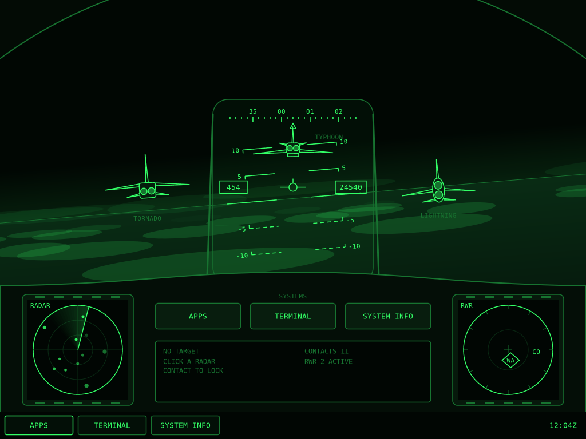

# Building a desktop OS on Linux: a write-up

Draft by Claude for Max to rewrite in his own words. It is an outline with the facts filled in, not a finished post. Everything stated here is true of the repo; the opinions and the "what I learned" parts are placeholders for Max.

## What it is

PerkinsOS is a Linux system that boots in QEMU straight to its own desktop: a Wayland compositor, a dock, an app launcher and a small app. The kernel, graphics libraries and terminal are upstream, built from source by Buildroot. The desktop on top is this repo.

## How it was built

Honest version, to keep: the plan, scope and review were Max's; the code was written with an AI assistant (Claude) over a few sessions, in small commits. The compositor is a fork of TinyWL, the ~1000-line reference compositor in wlroots, with every change marked in the source.

## The interesting parts

1. **Booting with no bootloader.** QEMU loads the kernel directly (`-kernel bzImage`), the root filesystem is one ext4 image on a virtio disk, and BusyBox init starts the compositor from a 40-line init script. Login prompt in about 5 to 10 seconds under software emulation.

2. **A compositor doesn't draw.** It keeps a scene graph and wlroots repaints what changed. Wallpaper, window borders and stacking order are all just nodes in the right tree. Adding borders was four rectangles per window; the bug along the way was adding the window's geometry offset twice, which put the border a title-bar's height too high.

3. **layer-shell is what makes a dock possible.** xdg-shell only describes ordinary windows. layer-shell lets a client say "bottom edge, full width, reserve 48 pixels". Implementing the server side was about 200 lines: one scene tree per layer, a function that arranges every layer surface on a screen, and keyboard focus for surfaces that ask for it.

4. **Clients are just programs with a shared-memory buffer.** The dock, launcher and app are plain C: connect, bind globals, create a surface, wait for configure, draw with cairo into memory shared with the compositor, commit.

5. **Testing a desktop with no screen.** The tests boot the real image headless, type into the serial console, press keys through QEMU's monitor, and take screenshots through the same monitor. CI builds the whole OS from scratch and runs them on every push. The demo GIF is produced the same way, including a GIF encoder in ~100 lines of Python because no image tools were installed.

## Numbers

- Buildroot 2026.02.3 (LTS), Linux 6.18.7, wlroots 0.19.2
- First build about 25 minutes on a laptop; rebuilding the compositor or shell takes seconds
- Compositor: stock TinyWL is 1084 lines; see `git diff 068d7ce --stat -- compositor/` for what was added
- CI run: about 27 minutes for the base image

## What I'd do next

See "Later" in the README: key repeat and mouse support in the launcher, a real wallpaper, server-side title bars, multiple screens.

## What I learned

(Max to write.)
